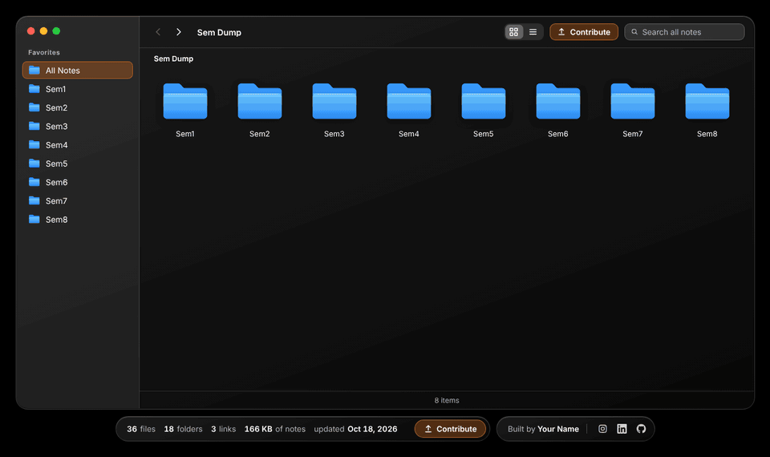
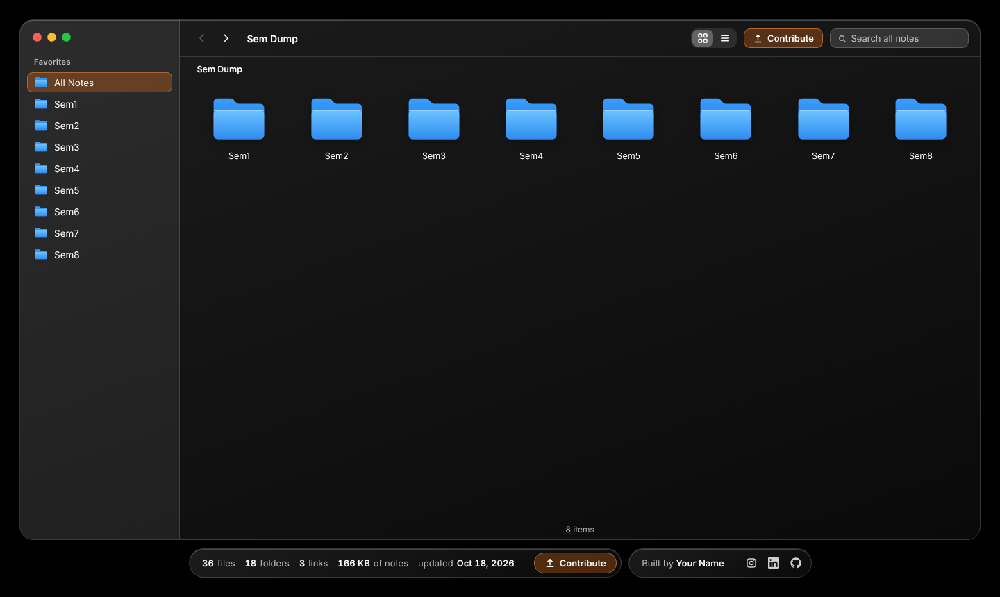
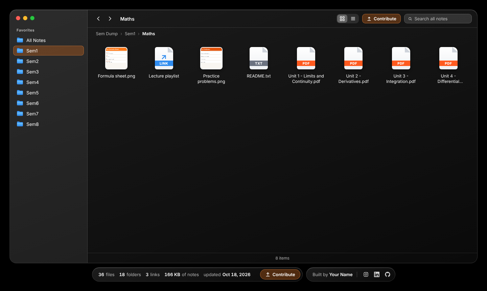
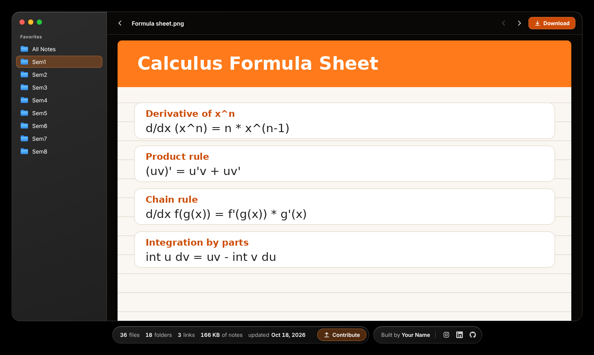
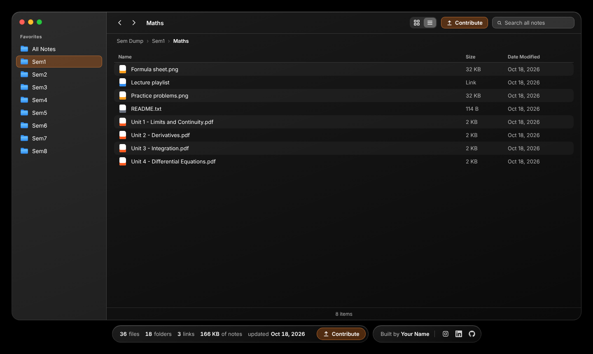
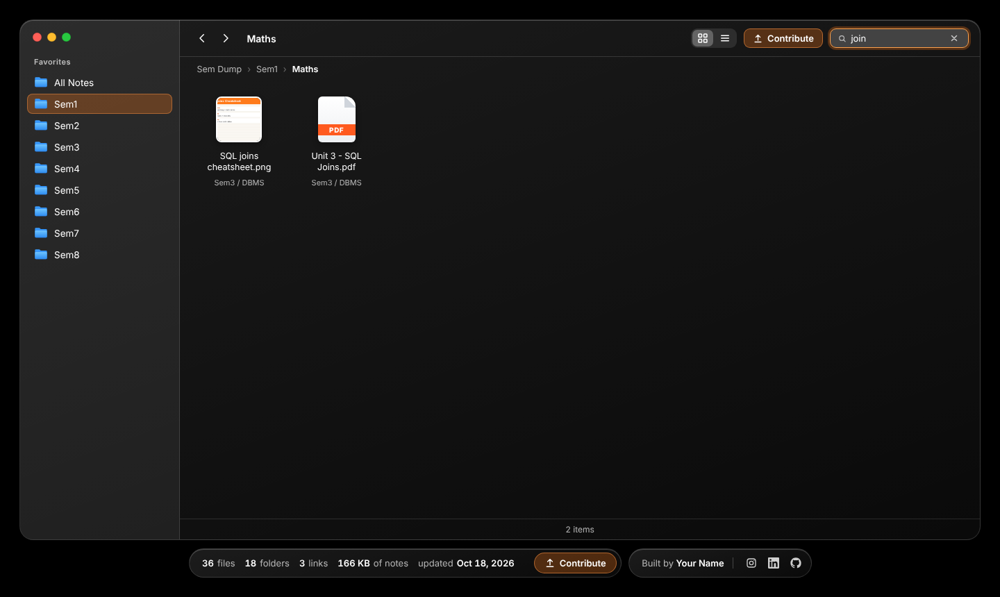
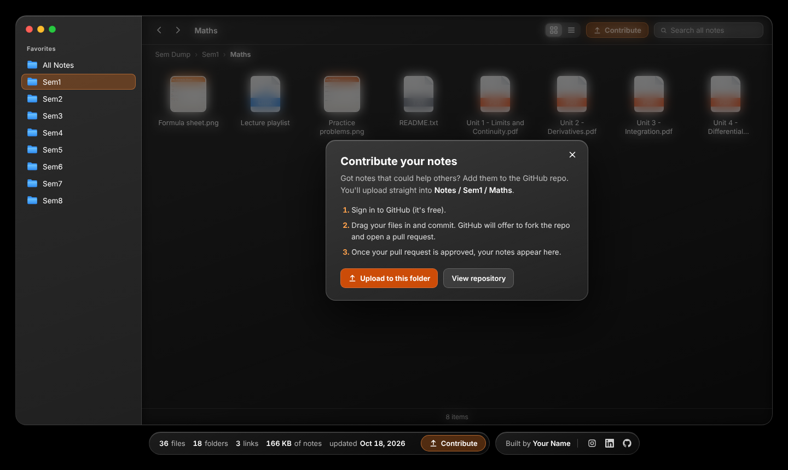
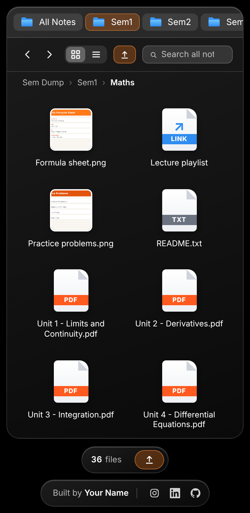

<p align="center">
  
</p>

<h1 align="center">Sem Dump</h1>

<p align="center">
  <b>A glassmorphic, macOS Finder-style home for semester notes.</b><br>
  Browse folders, preview PDFs and images right in the page, download what you need, and add your own notes in a few clicks.
</p>

<p align="center">
  <a href="https://YOUR_USERNAME.github.io/YOUR_REPO/"><b>Open the site</b></a> &nbsp;·&nbsp;
  <a href="#contribute-your-notes">Contribute notes</a> &nbsp;·&nbsp;
  <a href="#set-up-your-own-copy">Set up your own</a> &nbsp;·&nbsp;
  <a href="#troubleshooting">Troubleshooting</a>
</p>

<p align="center">
  
  
  
  
  
</p>

> **Note:** replace `YOUR_USERNAME` and `YOUR_REPO` in this file with your own GitHub details. Find and replace works well, and it makes the links and badges above come alive.


## See it in action

<p align="center">
  
</p>

<p align="center"><sub>Sample notes shown. Open a folder, preview a file, flip to the next one, search across everything, then contribute.</sub></p>


## What it does

| | |
|---|---|
| **Finder-style browsing** | Blue Mac-style folders for Sem1 to Sem8. Open them, nest them as deep as you like, go back, use breadcrumbs. |
| **Preview in the page** | PDFs, images (JPG, PNG, GIF, WebP, SVG) and text files open inside the window. Everything else downloads. |
| **One-click download** | Every preview has an orange **Download** button. |
| **Search everything** | One search box looks through the names of every file and folder, in every semester. |
| **Grid or list** | Icon view with thumbnails, or a tidy list with size and date. Your choice is remembered. |
| **Links inside folders** | Drop in a YouTube playlist, a Drive folder or any website as a clickable link. |
| **Live stats** | File, folder and link counts, total size and last update, plus GitHub stars and contributors. |
| **Contribute button** | Opens GitHub's upload page for the folder you are looking at. |
| **Shareable links** | Every folder and file has its own address you can send to a friend. |
| **Works on phones** | The layout adapts to any screen size. |


## Screenshots

<table>
  <tr>
    <td width="50%"><br><sub><b>Home.</b> Eight semester folders, ready to open.</sub></td>
    <td width="50%"><br><sub><b>Inside a folder.</b> PDFs, images, text files and links, each with its own icon.</sub></td>
  </tr>
  <tr>
    <td width="50%"><br><sub><b>Preview.</b> Read it here, or hit Download. The arrows flip between files.</sub></td>
    <td width="50%"><br><sub><b>List view.</b> Names, sizes and dates at a glance.</sub></td>
  </tr>
  <tr>
    <td width="50%"><br><sub><b>Search.</b> Finds matches in every folder and shows where each one lives.</sub></td>
    <td width="50%"><br><sub><b>Contribute.</b> A short guide, then straight to GitHub's upload page.</sub></td>
  </tr>
</table>

<details>
<summary><b>On a phone</b></summary>
<br>
<p align="center"></p>
<p align="center"><sub>The sidebar becomes a scrolling strip across the top, and tapping opens items.</sub></p>
</details>

<sub>Screenshots use sample notes, and the font in them may look slightly different from the live site.</sub>


## Using the site

**Browsing**

1. Pick a semester in the sidebar, or double-click a folder (tap it on a phone).
2. Keep going into subfolders. The breadcrumb bar at the top takes you back to any level.
3. Double-click a file to preview it. Press **Download** to save it.

**Window buttons**

| Button | What it does |
|---|---|
| Red | Closes the file preview |
| Yellow | Goes back to the home screen |
| Green | Makes the window fullscreen, and back again |

**Keyboard shortcuts**

| Key | Action |
|---|---|
| `/` | Jump to the search box |
| `Esc` | Close the preview or dialog, or leave the search box |
| `←` `→` | Previous or next file while previewing |
| `Enter` | Open the selected item |

**Sharing:** copy the address from the browser. Addresses look like `/#/Sem3/DBMS/Unit 1 - ER Model.pdf` and open that exact file or folder.


## Contribute your notes

Got notes that could help others? Add them in a few minutes. You need a free GitHub account, and nothing goes live until it has been reviewed.

1. **Open the site** and go to the folder where your notes belong, for example `Sem3 › DBMS`.
2. Click **Contribute**. The dialog shows the exact folder you will upload into.
3. Click **Upload to this folder**. GitHub opens in a new tab. Sign in if asked.
4. **Drag your files in.** If GitHub says you need to fork the repository, accept. That is how it works for everyone who is not the owner.
5. Write a short message such as `Add DBMS unit 3 notes`, then choose **Propose changes** and **Create pull request**.
6. Wait for approval. Once it is merged, your notes appear on the site automatically.

**Good contributions**

- Put files in the right semester and subject folder. Make a new subject folder if needed.
- Use clear names like `Unit 2 - Normalization.pdf` rather than `scan0012.pdf`.
- PDFs are best. Images (JPG, PNG) and text files also preview in the page.
- Only share notes that are yours, or that you are allowed to share. Remove personal information.
- GitHub limits uploads in the browser to **25 MB per file**. For larger files, share a link instead (see below).

**Sharing a link instead of a file**

Create a small text file whose name ends in `.url` and put the web address inside it:

```
Lecture playlist.url   →   https://youtube.com/playlist?list=...
```

It shows up as a link icon and opens the website in a new tab when clicked. The file name (without `.url`) is the label. On GitHub use **Add file › Create new file**, type the name, paste the address, and commit.


## Set up your own copy

You do not need a server, a database or a build tool. It is just files.

### Quick start

1. **Get the code:** click **Fork** at the top of this repository (or **Use this template**, if the owner has enabled it).
2. **Turn on hosting:** go to **Settings › Pages**, choose **Deploy from a branch**, pick `main` and `/ (root)`, and save. Your site will be at `https://YOUR_USERNAME.github.io/YOUR_REPO/`.
3. **Connect the Contribute button:** open `config.js` and fill in your details.

   ```js
   window.NOTES_CONFIG = {
     githubUser: "your-username",
     repo: "your-repo",
     branch: "main"
   };
   ```

4. **Add your name and links** for the footer in `profile.js`. Leave any field as `""` to hide it.

   ```js
   window.NOTES_PROFILE = {
     name: "Your Name",
     instagram: "yourhandle",
     linkedin: "your-linkedin-id",
     github: "yourusername",
     email: ""
   };
   ```

5. **Add notes** to `notes/Sem1` … `notes/Sem8` and commit. The included workflow rebuilds the file list for you.

### Adding notes

| You are on | Do this |
|---|---|
| **GitHub website** (or your phone) | **Add file › Upload files** into `notes/SemX/...`. The workflow updates the index in about a minute. |
| **Your computer** | Drop files into `notes/`, run `python3 update.py`, then commit and push. |

### Preview on your computer

```bash
python3 update.py --serve
```

Open <http://localhost:8000>. Only Python 3 is needed, with no packages to install. Opening `index.html` by double-clicking will not work, because browsers will not load `manifest.json` from a `file://` address.

### How it works

```
notes/  ──►  update.py  ──►  manifest.json  ──►  app.js draws the window
(your files)   (scans folders)  (list of everything)  (folders, preview, search)
```

`update.py` scans the `notes/` folder and writes `manifest.json`. The page reads that list and draws the window. When you add notes on GitHub, the workflow in `.github/workflows/update-manifest.yml` runs `update.py` for you and commits the new list.

<details>
<summary><b>Project layout</b></summary>

```
.
├── index.html                 the page
├── style.css                  all the styling (colours at the top)
├── app.js                     browsing, preview, search, stats, contribute
├── config.js                  your GitHub username and repo
├── profile.js                 your name and social links
├── update.py                  rebuilds manifest.json from notes/
├── manifest.json              generated list of every file (do not edit by hand)
├── notes/
│   ├── Sem1/ … Sem8/          your notes go here
├── assets/                    site icon files
├── docs/                      images used in this README
└── .github/workflows/
    └── update-manifest.yml    rebuilds manifest.json when notes change
```

</details>


## Customising

<details>
<summary><b>Change the colours</b></summary>

The orange accent is the `--accent` value at the top of `style.css`. A few button shades (such as `#cc4c08`) are set separately, so search the file for them if you want a full re-colour.

</details>

<details>
<summary><b>Rename the folders (for example Sem1 to Semester 1)</b></summary>

1. Rename the folders inside `notes/` (spaces are fine).
2. In `update.py`, change this line to match:

   ```python
   SEMESTERS = [f"Semester {i}" for i in range(1, 9)]
   ```

3. Run `python3 update.py`.

Links people have already shared will stop working, because the folder name is part of the address.

</details>

<details>
<summary><b>Change the site name, icon or font</b></summary>

- **Name:** search for `Sem Dump` in `index.html` and `app.js`.
- **Icon:** replace the files in `assets/` and `favicon.ico`.
- **Font:** Space Grotesk is loaded from Google Fonts in `index.html` and set in `style.css` (`--font`).

</details>

<details>
<summary><b>Supported file types</b></summary>

| Type | Extensions | Behaviour |
|---|---|---|
| PDF | `.pdf` | Previewed in the page |
| Images | `.jpg` `.jpeg` `.png` `.gif` `.webp` `.svg` `.avif` | Previewed, and shown as thumbnails |
| Text | `.txt` `.md` `.csv` `.log` | Previewed as text |
| Links | `.url` `.link` | Opens the web address in a new tab |
| Anything else | `.docx`, `.pptx`, `.zip`, … | Shown with a download-only view |

</details>


## Troubleshooting

<details>
<summary><b>The page says "Couldn't load notes"</b></summary>

`manifest.json` is missing, or the page was opened straight from a file. Run `python3 update.py`, then view the site through a web server (`python3 update.py --serve`) or through GitHub Pages.

</details>

<details>
<summary><b>I added files but they do not show up</b></summary>

The list is rebuilt from `notes/`. Run `python3 update.py` and push, or wait about a minute for the GitHub workflow to finish. If you use GitHub Pages, it can take a minute or two to publish. Then hard-refresh the page (`Ctrl+Shift+R`, or `Cmd+Shift+R` on a Mac).

If the workflow fails to push, go to **Settings › Actions › General › Workflow permissions** and choose **Read and write permissions**.

</details>

<details>
<summary><b>The Contribute button does not open GitHub</b></summary>

`config.js` still has the placeholder values. Fill in your GitHub username, repo name and branch. If your repo uses `master` instead of `main`, set `branch` to match.

</details>

<details>
<summary><b>The stats bar is missing, or has no stars</b></summary>

Replace `index.html`, `style.css` and `app.js` together, then hard-refresh. Stars and contributors only show once `config.js` is filled in, and only when GitHub can be reached. They are cached for an hour.

</details>

<details>
<summary><b>A PDF only shows its first page on my phone</b></summary>

Some mobile browsers cannot scroll PDFs inside a page. The **Download** button always works.

</details>


<p align="center">
  <b>Built by <a href="https://github.com/karfa113">Monojit Karfa</a></b><br>
  <sub>Made with plain HTML, CSS and JavaScript. Typeset in <a href="https://fonts.google.com/specimen/Space+Grotesk">Space Grotesk</a>.</sub>
</p>